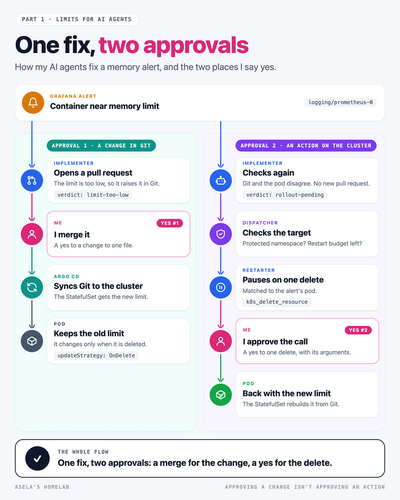
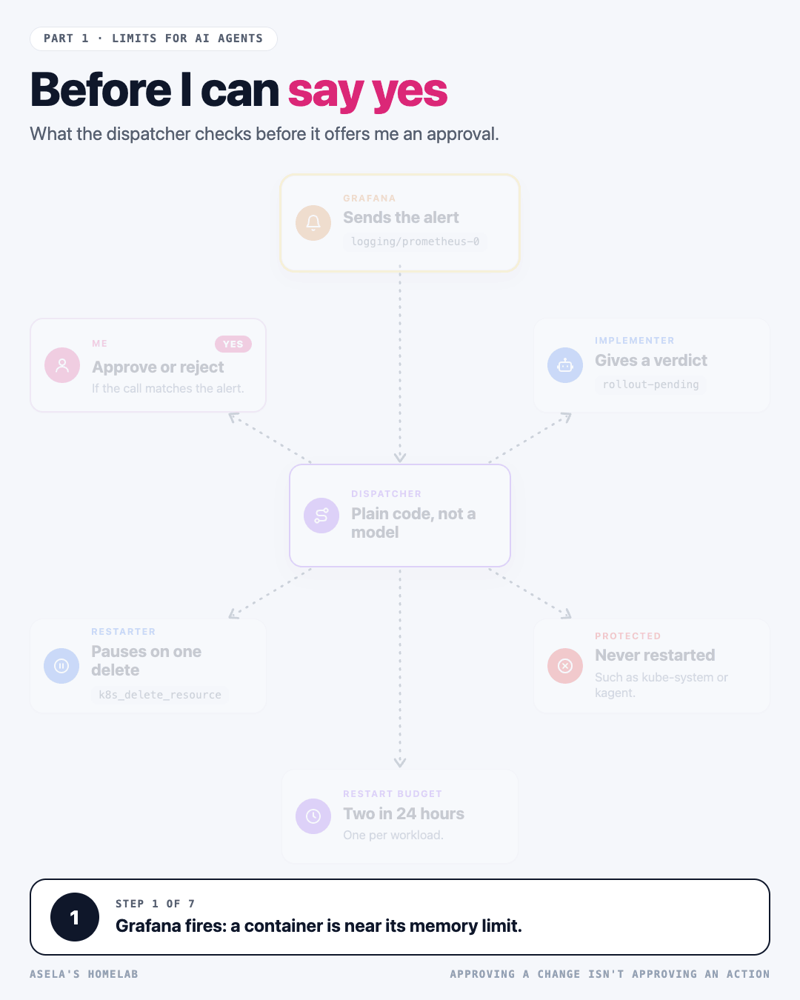

# blog-diagrams

Architecture, flow and approval diagrams for blog and LinkedIn posts, written as a short JSON
spec instead of drawn by hand. One engine draws every spec in the same flat, light house look:
rounded cards with icons, colors that stand for roles, a dot travelling along each arrow, and a
step band whose caption changes as each card appears.

| Lanes, the finished still | Hub, the animated GIF |
|---|---|
|  |  |

One command renders a spec to:

- a 2x PNG of the finished diagram, for an article
- a looping GIF, for Medium and LinkedIn
- an MP4, for a LinkedIn video post
- a step sheet, one panel per step, to review the animation without playing it
- an HTML page that plays the animation in a browser

Before anything is encoded, a layout check lists text that doesn't fit its card, cards and
labels that overlap, arrows that run through a card, and captions longer than two lines.

Three layouts, each with an example in `skills/blog-diagrams/examples/`:

| Layout | Draws |
|---|---|
| `lanes` | Parallel paths down the page, each a spine of steps |
| `flow` | An architecture or pipeline on a grid, with nested groups such as a cluster or namespace |
| `hub` | One component and everything it talks to |

Needs Node 22 or later (for the built-in WebSocket), Google Chrome or Chromium, and ffmpeg for
the GIF and MP4. Nothing to install: the renderer drives headless Chrome over the DevTools
protocol with no npm packages. From this folder:

```bash
node skills/blog-diagrams/scripts/render.mjs diagrams/my-flow.json --out images --still
node skills/blog-diagrams/scripts/render.mjs diagrams/my-flow.json --out images
```

Install: `/plugin install blog-diagrams@claude-agents-marketplace`
